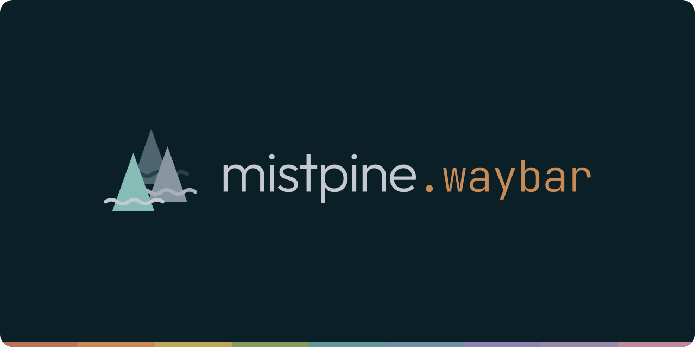
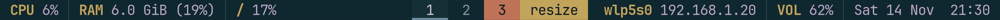

<p align="center">
  
</p>

<p align="center">
  
</p>

**mistpine** for [Waybar](https://github.com/Alexays/Waybar): cool, misty
grays over a deep blue-green night, with muted, earthy accents. It is the
Waybar port of [mistpine](https://github.com/mistpine/mistpine) and follows
the [mistpine spec](https://github.com/mistpine/mistpine/blob/main/docs/spec.md):
every color is the spec's, generated from its palette file and checked
against Waybar itself.

- The bar is a status line, as in mistpine's Neovim: `bg2` under `fg2`, with
  thin `bg4` separators between modules.
- Workspaces like windows in [mistpine.sway](https://github.com/mistpine/mistpine.sway):
  the focused one raised with a blue underline, urgent ones filled red, a
  binding mode in yellow.
- Generic selectors: the style works with any modules, in any order. It is
  tested on sway, and also styles the `active` workspaces and `submap` that
  Hyprland and niri use.
- Two files: `mistpine.css`, the palette for your own style, and
  `style.css`, the whole bar. An example config for the screenshot.
- Waybar 0.9.24 and later, including 0.15.

The screenshot is the real app, Waybar 0.15 on sway, and the render fails if
a single color comes out different from the spec.

## Install

```sh
mkdir -p ~/.config/waybar
for f in mistpine.css style.css; do
  curl -fsSL -o ~/.config/waybar/$f \
    https://raw.githubusercontent.com/mistpine/mistpine.waybar/main/themes/$f
done
```

This replaces your `style.css`; keep a copy first if you have one. Waybar
reloads the style on restart (`killall -SIGUSR2 waybar`, or log in again).

Set your font at the top of `style.css`: Waybar takes it from the style, and
this one ships `monospace` at 14px.

For the bar in the screenshot, take the example config too:

```sh
curl -fsSL -o ~/.config/waybar/config.jsonc \
  https://raw.githubusercontent.com/mistpine/mistpine.waybar/main/examples/config.jsonc
```

Its labels and values are colored with Pango markup in the config (Waybar's
markup cannot read CSS colors), so they are written as hex from the spec:
labels `yellow` `#c2a55b`, values `brightPurple` `#b8a8c6`. Plain `purple`
would sit at 4.49:1 on the bar, just under the spec's 4.5:1.

## Colors only

Keep your own `style.css` and take the palette: download `mistpine.css` as
above and import it at the top of your style:

```css
@import "mistpine.css";

window#waybar {
  background: @bg2;
  color: @fg2;
}
```

It defines every palette color, from `@bg0` to `@bright-cyan`:

| Names | Colors |
| --- | --- |
| `bg0` … `bg4` | `#071921` `#0b1f27` `#0f272e` `#152f37` `#26414a` |
| `fg0` … `fg3` | `#4e6570` `#8796a0` `#a7b0bb` `#c4c9d0` |
| `red` `orange` `yellow` `green` | `#be7356` `#c98b56` `#c2a55b` `#8a9a5b` |
| `cyan` `blue` `purple` `pink` | `#5f9a96` `#6f8fa8` `#8c84b4` `#c08a9c` |
| `bright-red` `bright-green` `bright-yellow` | `#d08a6e` `#a9b97a` `#dcc27e` |
| `bright-blue` `bright-purple` `bright-cyan` | `#93afc4` `#b8a8c6` `#86bcb6` |

## What `style.css` colors

| Element | Colors |
| --- | --- |
| The bar | `bg2` background, `fg2` text, `bg4` separators |
| Workspaces | `fg1`; hovered `bg3` and `fg3` |
| Focused workspace | `bg3`, `fg3`, a `blue` underline |
| Urgent workspace, critical battery or temperature, tray attention | filled `red`, `bg0` text |
| Binding mode (sway `mode`, Hyprland `submap`) | filled `yellow`, `bg0` text |
| Battery warning | `yellow` |
| Muted audio, offline network, Bluetooth off | `fg1` |
| Tooltips and tray menus | `bg0` with a `bg4` border, `fg3` text; hovered items `bg3` |

## Customize

Add your rules at the end of `style.css`, after mistpine's:

```css
* {
  font-family: "JetBrains Mono", monospace;
  font-size: 13px;
}

#clock {
  color: @blue;
}
```

## Development

Requires Node 24+, pnpm (`corepack enable`) and Docker.

```sh
pnpm install
pnpm generate  # themes/ and examples/ from the mistpine spec and src/
pnpm check     # fail if they are out of date
pnpm verify    # Waybar 0.9.24 and 0.15 load the style and show the spec's colors
pnpm render    # the README screenshot from Waybar, with pixel checks
pnpm banner    # assets/banner.svg and the social preview (Chromium)
pnpm lint && pnpm typecheck
```

Never edit `themes/` or `examples/` by hand. The style lives in
`src/style.css` and the example in `src/config.jsonc`; both may use colors
only by palette name. `scripts/generate.ts` reads the palette from
[`palette/mistpine.json`](https://github.com/mistpine/mistpine/blob/main/palette/mistpine.json)
(from `$MISTPINE_DIR`, `../mistpine` or GitHub), writes the files, checks that
the style's roles are still the spec's and requires 4.5:1 for every text
color on its background.

`pnpm verify` and `pnpm render` run Waybar on headless sway in Docker: Ubuntu
24.04 for Waybar 0.9.24, Ubuntu 26.04 for Waybar 0.15
(`scripts/render/Dockerfile`). verify loads the shipped style and example
config unchanged and fails on any error in Waybar's log (it stops at the
first CSS error and never shows the bar), then checks the bar's colors on
screen. render shows the bar at scale 3 with fixed values for the network,
volume and clock modules, checks every role's pixels, and crops the 26.04
shot for the README.

## Credits

- Designed in [themes.utimura.io](https://themes.utimura.io).
- [Outfit](https://github.com/Outfitio/Outfit-Fonts) and
  [JetBrains Mono](https://github.com/JetBrains/JetBrainsMono) in the banner.
  The screenshot uses JetBrains Mono.

## License

[MIT](LICENSE). Outfit and JetBrains Mono (in `scripts/fonts`, for the banner)
are under the SIL Open Font License 1.1.
